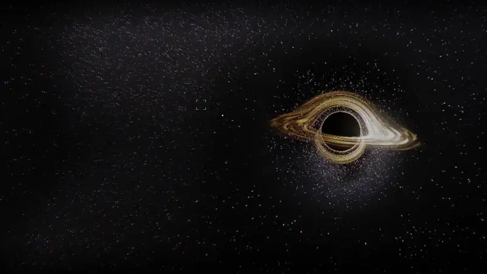

# Event Horizon

A portfolio template where the whole site is a fall into a black hole, ray traced live in the browser. Light bends around the hole, scrolling pulls the visitor onto ever closer orbits, and each section of the portfolio is a moment on the way in. The demo person, Rahel Tesfaye, is fictional, and so are her institute, employers, university, projects and papers. Replace them with your own in one file.

<p align="center">
  <a href="docs/preview.mp4"></a>
  <br>
  <sub>Click the preview to watch the full 40-second video (<code>docs/preview.mp4</code>).</sub>
</p>

**Use it:** click **Use this template** at the top of this page (or run `git clone https://github.com/Malaydoshi711/black-hole-portfolio-template.git`), then follow [Quick start](#quick-start) and [Make it yours](#make-it-yours) below. Everything you need to change lives in `src/data/content.ts`.

## Features

- **A real-time black hole.** A full-screen fragment shader traces light backwards from the camera through Schwarzschild spacetime. The starfield is lensed into arcs and doubled images, the accretion disk is turbulent and differentially rotating, Doppler beamed (white-hot on the side moving toward you, deep amber on the other) and redshifted, and the photon ring traces the edge of the shadow.
- **Point-source stars.** Each star is drawn as a round dot in screen space by pulling its sky offset back through the lensing Jacobian, so lensed images stay sharp.
- **Scrolling pulls you in.** About and Experience sit on wide orbits (one orbit per job), the flagship project is a group of bright bodies orbiting together (one per part), the projects are bodies in the disk that swing past as each card is read in a horizontal reel, publications are pulsars sweeping their beams (awards shine gold), Toolkit races near the inner edge, and Contact crosses the photon sphere: the shadow swallows the screen, space ripples, and it settles into a calm view framed by the photon ring.
- Bodies are ray traced too, so ones behind the hole are really lensed. Thin instrument lines draw their orbits and labels follow them.
- HUD readouts show the camera's orbital radius and gravitational clock rate; the disk slows as you fall in.
- Loader: "acquiring signal" while a gravitational-wave chirp (inspiral, merger, ringdown) draws itself, then the camera falls in from far out.
- "Ask my agent" console, Ctrl/Cmd + K command palette, custom cursor, optional low drone (off by default).
- Everything adapts to the content: the number of projects sets the bodies in the disk, publications set the pulsars (and the Research section disappears with none), nav numbers and palette entries follow.

## Quick start

Node 20.19+ or 22.12+ (Node 22 LTS recommended).

```bash
npm install
npm run dev        # http://localhost:5173
npm run build      # type-check and build into dist/
npm run preview    # serve the production build
```

There is no test suite. `npm run build` runs the TypeScript check.

## Make it yours

1. **`src/data/content.ts`** is the only file you need for text. Its exports:
   - `site`: public URL, page title and description, language, resume path and download name, social card image and alt text, footer note, social links, the "more work" link at the end of the project reel.
   - `profile`: name, role, hero headline, location, city label, coordinates, email, pronouns (used by the agent), intro, About heading and paragraphs.
   - `experience`: jobs, newest first. `short` is the label on its orbit in 3D.
   - `education`: degrees (used by the agent, the resume and SEO data).
   - `categories`: project categories and their colours.
   - `featured`: the flagship system. Its `parts` become the bright bodies that orbit together.
   - `projects`: the reel. Four to fourteen work; eight to eleven look best. `award: true` turns the badge gold.
   - `publications` and `research`: papers and talks plus section copy. Zero to six entries.
   - `skills`, `certifications`, `contact`.
2. **Site URL:** set `site.url`. The canonical link, Open Graph tags, JSON-LD Person, `sitemap.xml` and `robots.txt` are all generated from it at build time by the small plugin in `vite.config.ts`.
3. **Resume:** put your PDF at `public/Resume.pdf` (or change `site.resume`), and set `site.resumeName` for the downloaded file name.
4. **Social card:** replace `public/og.png` with a 1200x630 image. The easiest way is to run `npm run preview`, open the site in a 1200x630 window, wait for the intro to finish and take a screenshot of the hero.
5. **Icons:** edit the initials in `public/favicon.svg`, and export a 180x180 PNG of it as `public/apple-touch-icon.png`.
6. **Colours and fonts:** UI tokens are at the top of `src/styles.css` (a comment there lists every place colours live). 3D body colours are in `PALETTE` at the top of `src/world/World.ts`, the disk and sky in `src/world/shaders.ts`. Fonts come from `@fontsource` packages imported in `src/main.tsx`.
7. **Footer note:** set `site.footerNote` to `""` to remove the "Sample portfolio" line.
8. **Optional LLM for the agent:** see below.

## How "Ask my agent" works

The console (`src/components/Agent.tsx`) runs entirely in the browser. `src/agent/kb.ts` turns `content.ts` into a small knowledge base, ranks it against the question with BM25 plus a synonym map built from your own content, and composes an answer from the best matches. It shows a short Query, Retrieve, Reason, Respond trace while it works. Suggested questions are written from your content too. No key, no cost, no network call.

To get generative answers instead, deploy on Vercel and set these environment variables, then redeploy. `api/ask.ts` retrieves context on the server, is rate limited per IP, and builds its system prompt from `content.ts`. On any error the site falls back to offline answers.

| Variable | Example | Notes |
|---|---|---|
| `LLM_API_KEY` | a Groq or OpenAI key | required to enable |
| `LLM_BASE_URL` | `https://api.groq.com/openai/v1` | optional, any OpenAI-compatible API |
| `LLM_MODEL` | `llama-3.3-70b-versatile` | optional |
| `VITE_LLM` | `1` | tells the browser to call `/api/ask` |

## Deploy

- **Vercel:** import the repository, framework preset Vite (build `npm run build`, output `dist`), deploy, then add your domain under Settings, Domains. `vercel.json` sets caching and security headers. Vercel Analytics loads only in production on a real domain.
- **Netlify:** build command `npm run build`, publish directory `dist`.
- **Any static host:** upload `dist/`. The agent then uses offline answers only.

## Performance and accessibility

- The hole is traced at a fraction of the screen resolution and upscaled; the fraction follows the frame rate. If frames stay slow at the lowest resolution, bloom is dropped, the march takes fewer steps, the pixel ratio drops to 1 and the glass blur is turned off.
- Rays that never come near the hole skip the march and use the analytic weak-field bend.
- Phones get fewer steps, a lower starting resolution, a stacked layout and a vertical project list.
- `prefers-reduced-motion`: no smooth scrolling, no intro, no ripple or smear effects, the disk holds still and content is visible immediately.
- No WebGL: a styled CSS black hole is shown and all content stays readable.
- Skip link, keyboard-reachable nav, palette and agent (Esc closes), focus outlines, and an `aria-live` region for agent answers.

## Project structure

```
src/
  data/content.ts      all content and site settings (edit this)
  App.tsx              sections, HUD, boot sequence, scroll choreography
  styles.css           layout and theme tokens
  shared.css           cursor, agent console and palette styles
  main.tsx             entry, font imports
  world/World.ts       renderer, camera, bodies, labels, adaptive quality, 3D palette
  world/route.ts       sections and camera keyframes along the scroll
  world/shaders.ts     black hole ray tracer, bloom, composite, orbit lines
  world/audio.ts       WebAudio drone
  agent/kb.ts          knowledge base, retrieval, answer composer, LLM system prompt
  components/          Loader, Cursor, Agent console, Palette
api/ask.ts             optional LLM endpoint (Vercel Edge Function)
vite.config.ts         builds index.html meta, sitemap.xml and robots.txt from content
public/                resume, social card, icons
```

## Credits

Built with [Three.js](https://threejs.org), [GSAP](https://gsap.com), [Lenis](https://lenis.darkroom.engineering), [React](https://react.dev) and [Vite](https://vite.dev). Fonts (Michroma, Schibsted Grotesk) from [Fontsource](https://fontsource.org).

## License

MIT, see [LICENSE](LICENSE). You are free to use this template for your own portfolio, change it and publish it. The demo person, companies and projects are fictional.
